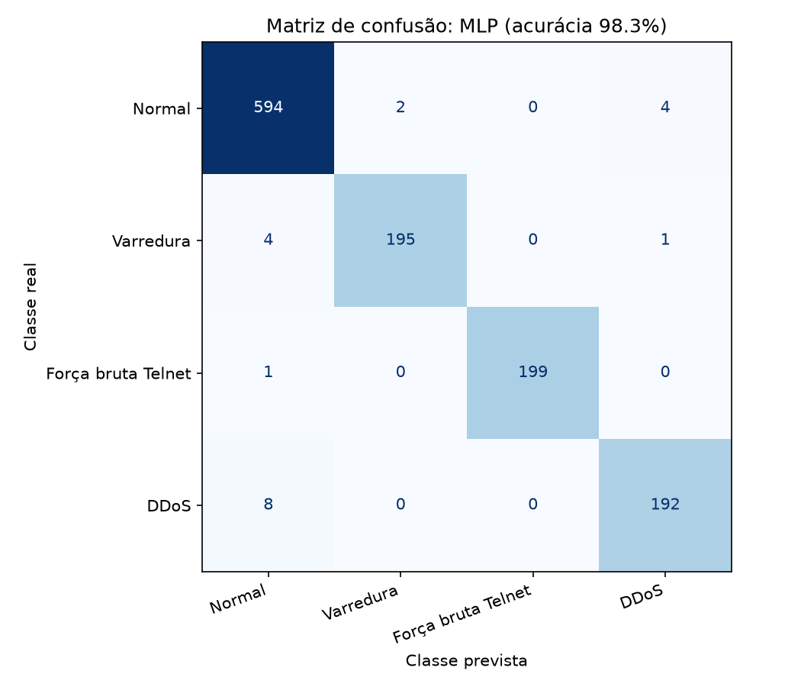

# Segurança em IoT

Seminário do **Clube de Programação e Machine Learning** (Infnet, dezembro de 2026)
por **Pietro Luchetta Giraldi**.

Bilhões de dispositivos IoT estão ligados à internet com senha padrão, sem atualização e sem ninguém olhando.
Este repositório mostra o problema **no próprio código feito em aula** e ataca o assunto por dois lados:

1. **Prevenção:** o projeto Raspberry Pi Pico W + DHT22 + ThingSpeak (aula de 05/11) em duas versões, uma insegura e outra corrigida.
2. **Detecção:** uma rede neural MLP (scikit-learn, como na aula de 12/11) que reconhece o tráfego de um dispositivo infectado.

> Uso educacional e defensivo. Nada aqui ataca sistemas de terceiros.

## Estrutura

```
wokwi/
  01_inseguro/main.py               código da aula, com 7 falhas marcadas "PROBLEMA n"
  01_inseguro/diagram.json          circuito (Pico W + DHT22 no GP4)
  02_seguro/main.py                 mesma função, com as falhas corrigidas ("CORREÇÃO n")
  02_seguro/config_secreta_exemplo.py   modelo do arquivo de segredos
  02_seguro/diagram.json
detector/
  detector_ataques_iot.py           gera os dados, treina a MLP e avalia
  resultados/                       matriz de confusão (.png) e dataset gerado (.csv)
requirements.txt
```

## 1. Simulação no Wokwi

1. No [Wokwi](https://wokwi.com), crie um projeto **MicroPython → Raspberry Pi Pico W**.
2. Cole o conteúdo de `diagram.json` na aba `diagram.json` e o de `main.py` na aba `main.py`.
3. No [ThingSpeak](https://thingspeak.com), crie um canal com **Field 1 = temperatura** e **Field 2 = umidade** e copie a **Write API Key**.
4. Versão insegura: cole a chave direto no `main.py`.
   Versão segura: crie no Wokwi um arquivo `config_secreta.py` (copie o modelo `config_secreta_exemplo.py`) e coloque a chave nele.
5. Rode, clique no DHT22 para mudar temperatura e umidade e acompanhe o gráfico no ThingSpeak, que atualiza a cada 15 s.

| # | Problema na versão da aula | Correção |
|---|---|---|
| 1 | API key escrita no código | segredos em `config_secreta.py`, fora do Git |
| 2 | HTTP em texto puro | HTTPS (TLS) |
| 3 | leitura do sensor sem validação | trata erro e descarta valor fora da faixa física |
| 4 | não confere a resposta | checa status e corpo, usa timeout e backoff exponencial |
| 5 | log imprime a chave | chave mascarada |
| 6 | espera infinita pelo Wi-Fi | tempo-limite e reconexão |
| 7 | um erro derruba o dispositivo | `try/except` no loop e watchdog |

**Limitação conhecida:** no MicroPython o TLS criptografa a conexão, mas por padrão **não valida o certificado** do servidor.
Em produção é preciso embarcar o certificado da CA e usar `ssl.SSLContext` com `CERT_REQUIRED`.
No plano gratuito do Wokwi o projeto é **público**, então use uma chave de teste e gere outra depois.

## 2. Detector de ataques com MLP

```bash
python -m venv .venv
.venv\Scripts\activate          # Windows (Linux/Mac: source .venv/bin/activate)
pip install -r requirements.txt
python detector/detector_ataques_iot.py
```

Também roda no Google Colab: basta colar o script numa célula, já que as bibliotecas vêm instaladas.

- **Dados:** 6.000 janelas de tráfego de 10 s, **sintéticas**, com 8 features: pacotes/s, tamanho médio, IPs e portas de destino, fração SYN, tentativas de Telnet, % de saída e duração.
- **Classes:** Normal (sensores e câmeras), Varredura, Força bruta Telnet (estilo Mirai) e DDoS. Cerca de 12% dos ataques são "discretos", feitos para parecer normais.
- **Modelo:** `StandardScaler` → `MLPClassifier(hidden_layer_sizes=(32, 16))`, com divisão 80/20.

Resultado (semente 42):

| Métrica | Valor |
|---|---|
| Acurácia | 98,3% (96,9% sem normalização) |
| Ataques classificados como normais (falsos negativos) | 13 de 600 |
| Tráfego normal acusado como ataque (falsos positivos) | 6 de 600 |



Como os dados são sintéticos, o desempenho com tráfego real seria menor. Próximo passo: treinar com datasets reais como
[CICIoT2023](https://www.unb.ca/cic/datasets/iotdataset-2023.html),
[N-BaIoT](https://archive.ics.uci.edu/dataset/442/detection+of+iot+botnet+attacks+n+baiot) ou
[TON_IoT](https://research.unsw.edu.au/projects/toniot-datasets).

## Referências

- IoT Analytics: [Number of connected IoT devices](https://iot-analytics.com/number-connected-iot-devices/)
- OWASP: [Internet of Things Top 10](https://owasp.org/www-project-internet-of-things/)
- Antonakakis et al., [Understanding the Mirai Botnet](https://www.usenix.org/conference/usenixsecurity17/technical-sessions/presentation/antonakakis), USENIX Security 2017
- Zscaler: [ThreatLabz 2025 Mobile, IoT & OT Threat Report](https://www.zscaler.com/campaign/threatlabz-mobile-iot-ot-report)
- SonicWall: [2025 Cyber Threat Report](https://sonicwall.com/resources/white-papers/executive-summary-2025-sonicwall-cyber-threat-report)
- Bitdefender e Netgear: [2025 IoT Security Landscape Report](https://blogapp.bitdefender.com/hotforsecurity/content/files/2025/10/2025_iot_security_report.pdf)
- Cloudflare: DDoS Threat Report, 3º trimestre de 2025 (botnet Aisuru, 29,7 Tbps)
- Anatel: [Alerta sobre o malware BadBox 2.0 em TV boxes piratas](https://www.gov.br/anatel/pt-br/assuntos/noticias/anatel-emite-alerta-sobre-malware-bad-box-2-0-em-tv-boxes-piratas/alerta-anatel.pdf/@@download/file) (ago/2025)
- Anatel: Ato nº 77/2021, requisitos de segurança cibernética para equipamentos de telecomunicações

## Contato

pietro.giraldi.tb@gmail.com · [linkedin.com/in/pietro-luchetta](https://www.linkedin.com/in/pietro-luchetta/)
